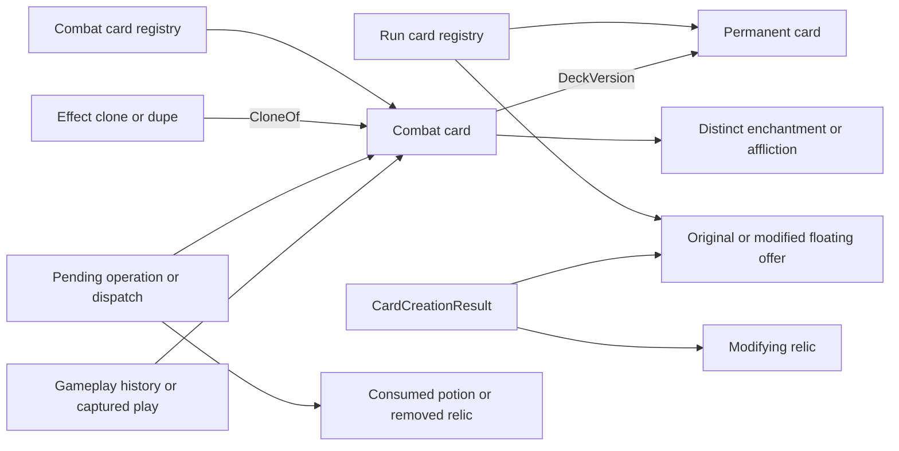

# Cards and inventory lifetime audit

This is source-derived evidence for the lifetime decision, not an implementation or
new runtime parity result. Source paths below are relative to the pinned local
`build/combat-state-audit/decompiled/`; exact hashes and inspected ranges are retained
in `cards-inventory.json`. Adapter sources are explicitly identified separately.

## Identity and membership

`MegaCrit.Sts2.Core.Entities.Players/Player.cs:806–815` creates a fresh combat clone
for each permanent deck card and sets `combatClone.DeckVersion = permanentCard`,
then adds the clone to Draw and randomizes that pile. The permanent deck card is
not moved into combat. Within a domain, pile movement retains an instance identity;
deck-to-combat initialization creates a distinct identity and a link.

`MegaCrit.Sts2.Core.Models/CardModel.cs:1198–1241` deep-clones local keywords,
DynamicVars, energy cost, temporary star costs and attached enchantment/affliction,
rebinding attachments to the new card. Its native AfterCloned resets CurrentTarget,
CurrentPlayIndex, DeckVersion, removal flag and event delegates. `:2182–2227` separately
implements effect clones (`CloneOf`) and temporary dupes (`IsDupe`), and resets
ExhaustOnNextPlay for a newly created effect clone. These are native *creation*
operations, not a full simulator state-copy algorithm: applying them blindly during
checkpoint/clone restoration would erase pending execution and identity links.

The architecture's statement that a persistent card moves between deck/combat zones
without changing identity (`full-game-simulator-architecture.md:176–180`) conflicts
with these sources and the normative state inventory. Preserve distinct permanent
and combat objects and their DeckVersion relation; interpret unchanged identity only
for actual pile moves of the same object. No semantic ownership choice permits
collapsing those two records into one mutable instance.

## Floating cards and logical removal

`MegaCrit.Sts2.Core.Runs/RunState.cs:383–453` registers newly created, loaded and
cloned cards in `_allCards`, independently of deck membership. Creation calls
AfterCreated; load does not. Scope RemoveCard removes the registry entry and clears
Owner, but that API differs from normal logical removal. CombatState has analogous
create/clone/add/contains/remove methods (`MegaCrit.Sts2.Core.Combat/CombatState.cs:168–216,519–525`).

`CardModel.cs:1599–1608` implements RemoveFromState as removing current pile membership
and setting HasBeenRemovedFromState. It does **not** remove the scope registry entry,
clear Owner, or erase DeckVersion/CloneOf. A source-tree call-site search found no
normal gameplay `.RemoveCard(...)` calls beyond a mock; normal logical removal
therefore cannot be used as proof that the underlying native object was reclaimed.
Both run and combat `_allCards` are strong lists for their scope lifetime unless an
explicit scope API removes an entry. This is a native retention fact, not a mandate
that C++ preserve unreachable bytes forever.

Floating reward cards are real registered instances. `MegaCrit.Sts2.Core.Entities.Cards/CardCreationResult.cs:7–37`
holds originalCard, optional modifiedCard and ordered modifying relic references.
SilkenTress (`Models.Relics/SilkenTress.cs:47–82`) clones a generated reward card,
enchants the clone, and substitutes the displayed/selected Card through the result.
The original is still referenced by CardCreationResult; original and modified offer
must not be conflated. ArchaicTooth.SetupForPlayer (`Models.Relics/ArchaicTooth.cs:104–119,149–166`)
can create a real transformed card in the run scope merely to save its descriptor
for an offer. Its serialized descriptors are values; the live deck card remains a
separate instance. Pure-looking previews are not universally safe to recompute when
generation or registration has already occurred.

`MegaCrit.Sts2.Core.Commands/CardPileCmd.cs:53–88,110–208` records removal information
and callbacks before marking a card logically removed. Combat removal first removes
pile membership, then runs AfterCardChangedPiles, then RemoveFromState. Captured
old-pile data and source references remain live across those awaits. Transform
(`Commands/CardCmd.cs:371–455`) captures original, old pile/index and replacement,
removes originals from their piles, sorts by original index, inserts replacements,
records history and invokes source/replacement callbacks. The original is not simply
overwritten by the replacement and remains referenced by operation/history.

## Consumed potions and removed relics

`MegaCrit.Sts2.Core.Entities.Players/Player.cs:692–706` removes a used potion by
nulling its actual slot, not compacting slots or clearing the potion's Owner.
`MegaCrit.Sts2.Core.Models/PotionModel.cs:228–239,297–353` sets removal on discard/use;
OnUseWrapper removes it before BeforePotionUsed and before the OnUse effect, pushes
the source onto choice contexts, and runs a branching asynchronous effect. After
resumption it still accesses the same potion/Owner for history, after-use callbacks
and empty-hand processing. Consumed is not destroyed: retain the source, captured
target, mutable values and continuation until all downstream consumers finish.
Its removed flag prevents ordinary subscription, not direct source use.

Dense-route corroboration must name the *after-action* boundary precisely: the
consumed Skill Potion is retained after `action-000384` until selection
`action-000385`; Colorless Potion is retained after `action-000611` until selection
`action-000612`; another Skill Potion is retained after `action-000646` until
selection `action-000647`. The selecting actions consume the preceding snapshots;
the retained source is no longer present in the snapshots after those selections.
The parent audit preserves the extracted evidence separately. This corroborates
these three cases, not all consumed-source lifetimes.

`Player.cs:452–523` retains relic acquisition order and sets Owner. Removal drops the
inventory entry, marks logical removal and unhooks presentation handlers; Owner is
not cleared. Melting keeps the inventory instance but sets melted/status flags.
`MegaCrit.Sts2.Core.Commands/RelicCmd.cs:35–93` invokes AfterObtained after insertion
and invokes AfterRemoved after removal/melting; replacement keeps the original
inventory position but is another instance. An in-flight acquisition, removal,
purchase or trigger must retain its removed/replaced source until it no longer
reads that source. An inventory list alone is therefore insufficient ownership.

The observed potion roots declare no additional per-model storage in the semantic
inventory; base owner/removal/queued state and dynamic values still matter. Do not
generalize that absence to all potions or assume native save fields cover runtime.

## Model-specific inventory retention and reset boundaries

The prior per-root semantic inventory holds complete local effects; this table
classifies the lifetime-sensitive state inspected here. A reset occurs at the
native hook, not automatically when allocating a new room or publishing a prompt.

| Models | State and native reset boundary |
| --- | --- |
| ArchaicTooth | Saved starter/replacement card descriptors persist with relic. Hover-tip list is derived presentation state, reset on native cloning; do not confuse descriptors with live card references. |
| SilkenTress | Saved IsUsed persists across combats; first qualifying reward modification consumes it. Original/modified reward cards and modifying relic source coexist until the reward operation ends. |
| SeaGlass | Saved character identity determines future reward pool; persist with relic, independent of its generated transient offers. |
| Nunchaku | Saved AttacksPlayed persists across combats. No generic combat reset; activation flag/status has separate UI/operation timing. |
| Pendulum | Saved TurnsSeen persists and advances modulo its interval at BeforeHandDraw; AfterCombatEnd normalizes Status, not the saved turn counter. |
| JossPaper | Saved CardsExhausted persists; EtherealCount is turn-local, cleared after its side-end processing and combat-end hook. Activation state spans its own callback sequence. |
| LetterOpener | SkillsPlayedThisTurn reset at BeforeCombatStart and qualifying later side starts; combat end resets status/activation. Do not infer every field is cleared by AfterCombatEnd. |
| RainbowRing | Typed play counts and ActivationCountThisTurn reset at qualifying side start and combat end. |
| BurningSticks | WasUsedThisCombat reset on combat-room entry and combat end. |
| CentennialPuzzle | UsedThisCombat reset at AfterCombatEnd. |
| Permafrost | ActivatedThisCombat reset at AfterRoomEntered for CombatRoom, not a global room transition. |
| RedSkull | StrengthApplied tracks whether its conditional strength is installed; room-entry/current-HP hooks update it and combat end clears it. |

Flags whose only consumers are presentation may be omitted from the deterministic
kernel only after proving their public projection can be reconstructed without
changing callbacks, eligibility or future behavior. This audit does not classify an
`IsActivating` spelling as automatically gameplay or automatically discardable.

## Native graph and safe retirement conditions

Storage cannot be retired solely because a card leaves a pile, an offer is skipped,
a potion slot is empty, an inventory entry is removed, or a removal flag is true.
The semantic precondition is that no authoritative membership, live continuation,
captured event/dispatch list, gameplay-history consumer, pending choice/result,
DeckVersion/CloneOf/attachment relation or required export still needs that identity
or its values. Preserve subscription eligibility separately from reachability.
Cards retained in native registries may be logically excluded from hooks: combat
Contains checks removed flags and active-owner conditions (`CombatState.cs:556–601`).

Whole-scope retirement requires the parent combat/room/run analysis as well as this
graph. C++ may choose arena lifetime, reference tracking or another strategy, but
must preserve logical references, identity generation and future behavior. Native GC
timing is not itself a simulator contract; reclaiming earlier requires a semantic
proof, not an observed collection maximum or blanket removed-object rule.

## Clone, checkpoint and export implications

- Deep-copy the semantic graph with an old-to-new identity map; repeated edges must
  resolve to the same cloned instance while parent/siblings remain independent.
- Preserve deck/combat identity domains, DeckVersion/CloneOf, source/target references,
  removal flags, ordered memberships, mutable modifiers and pending operation data.
  Retain a detached deck version even if the permanent card was removed mid-combat.
- Restore saved operation stage and captured values. Do not call native-style
  AfterCreated/AfterCloned/reset hooks as an accidental restore side effect.
- Validate dangling references, owner/domain consistency, removal/membership
  compatibility and attachment back-references before publishing a restored state.
- Retire storage only after semantic consumers end; preserve required allocator/free
  slot generation/order state. No arbitrary fixed capacity follows from this run.

`tools/oracle/adapters/RecordingSession.cs:228–304,354–371,433–479` exports an identity
graph reachable from registered inventory, active plays, pending sources, histories
and discovered model fields. Missing inventory sources are added to
retained_inventory_models. It explicitly exports DeckVersion/CloneOf and detached
deck versions, including removed flags and runtime attachment/cost data. These
adapter paths corroborate necessary retained relationships but do not enumerate all
native scope `_allCards` or prove complete reachability/continuation coverage. In
particular a comparison snapshot is not a restorable checkpoint merely because its
references resolve; the pending native async locals need simulator-owned semantics.

## Required regressions and limits

Test a deck card and combat clone independently, remove/transform the permanent
version while the clone remains, then checkpoint/clone/resume and compare exact
references and later hooks. Test same-ID duplicate cards and chained CloneOf/dupe
relationships. Suspend with original/modified offers, skip/cancel/select, and verify
no reroll, lost source or accidental replay of AfterCreated. Suspend Skill Potion
after slot removal and resume choice/skip with sparse slots; verify source identity
and exactly-once callbacks. Remove/replace a relic during a captured dispatch and
check both logical eligibility and remaining direct source uses. Carry saved counters
through two combats while resetting only native turn/combat flags.

No live experiment or engine change was performed. Source graph inspection establishes
these requirements, not exhaustive runtime reachability. Sources span common native
mechanisms and lifetime-sensitive observed inventory models; full content introduces
additional model-owned references which require the same consumer analysis. The
parent audit owns histories, entity lifecycle and room/combat retirement. No contract
exception or allocator/layout decision is made here.
