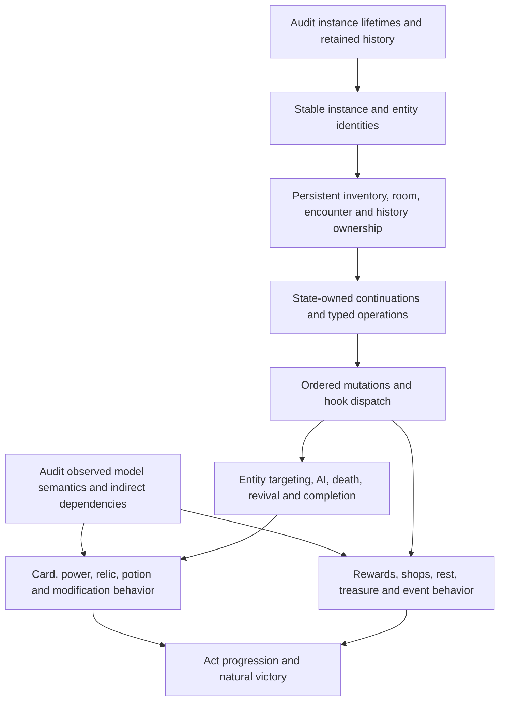

# Victory mechanic scope and dependency decisions

Decision record for [Choose general mechanic boundaries and dependencies for victory replay](https://github.com/TonyinBio/sts2-cpp/issues/3), within
[the complete simulator map](https://github.com/TonyinBio/sts2-cpp/issues/1).
This is a planning artifact, not implemented support or parity certification.

## Confirmed scope

The first milestone must replay the victory through general mechanics. Fully
implement models that appeared in gameplay, including unchosen offers and models
never manually played, together with their required semantic dependencies. Merely
generating or displaying those observed models is insufficient. Cover their legal
branches, upgrade behavior and parameterized variants; the observed variant is
evidence, not a license to hardcode it.

The inventory scans all 696 actions and 697 dense complete-state boundaries from
[the verified recording](https://github.com/TonyinBio/sts2-cpp/tree/7d7c9db45fa08e65f7a6e9d15b07624ce1945359/tests/parity/fixtures/reference/run-victory-1234).
The initial implementation roots are:

| Category | Distinct observed roots |
| --- | ---: |
| Cards | 71 |
| Relics | 31 |
| Potions | 15 |
| Stored powers | 39 |
| Monsters | 30 |
| Entered encounters | 22 |
| Entered events | 11 |
| Enchantments | 3 |
| Afflictions | 2 |

Exact IDs are in `scope-roots.json`. Roots combine owned/runtime models with actual
reward, merchant, event-option and treasure offers. They exclude mere presence in
future setup queues, unlock lists or unused random pools. Support for setup, travel,
all reached room categories, three-act progression, history and natural victory is
also required; the table is a content inventory, not the whole feature inventory.

Preserve complete native eligibility pools and RNG consumption, including candidates
outside these roots. Models outside the expanded scope may retain explicit
unsupported effects until their implementation; do not filter pools, substitute
outcomes or call their interactions verified. This is the scoped first milestone,
not final completion of the full pinned single-player contract. Required dependencies
inside an observed model's own semantics cannot be omitted just because the recorded
branch did not exercise them. The source audit must distinguish those dependencies
from the additional model implementations reachable through broad random generation.

## Shared execution decision

Use one state-owned representation and execution mechanism for unfinished work
across combat, potions, rewards, shops and events. Keep typed system-specific frames
and handlers: common resumption machinery does not impose one payment/trigger/effect
ordering on every mechanic. Preserve each audited native operation order.

For example, Skill Potion leaves inventory, offers cards, waits, and resumes after
selection. The complete state must preserve the consumed potion as a source and
remember the unfinished operation even though the potion no longer occupies a slot.
The same ownership and resumption rules apply to nested card effects, event choices
and merchant operations. Clone/checkpoint/restore must preserve pending work, source
references, partial selections, dispatch position and ordering.

Use shared entity lifecycle, targeting, mutations and ordered hooks. Do not encode
each recorded encounter's timing as a separate shortcut. Retain the existing indexed
rules/programs plus exceptional native-handler design, checked growth, deterministic
kernel and separate observation projection. No runtime game-DLL, JSON or filesystem
dependency enters the kernel. No correctness exception is approved here.

## Dependency map



This graph identifies dependencies, not a mandate for a large foundational rewrite.
Deepen shared domains through observable integrated slices, preserving verified setup,
RNG, maps and existing replay paths. Every introduced domain includes its codec,
clone/restore validation, privileged export and regression evidence in the same slice.
Use measured checked storage growth; observed collection maxima are not capacities.
The later milestone-order decision owns implementation slicing and sequencing.

## Concrete ownership and behavior requirements

- Permanent deck cards and combat copies may be distinct native objects linked by
  `DeckVersion`. Preserve separate identities and explicit links where the game does.
  The normative [state inventory](../../specs/engine/state-inventory.md) requires this;
  the architecture's simplified movement wording must not collapse those objects.
- Consumed potions remain continuation sources in the boundaries after actions 384,
  611 and 646, immediately before selections 385, 612 and 647, in
  `/combat/retained_inventory_models`. Those exporter entries disappear after the
  selections; that does not prove native destruction. Slot membership and lifetime
  are different. The lifetime audit clarifies these before/after action identities.
- Potion indices refer to `slot_index`, not compact-list position. Action 650 targets
  slot 2 while only one potion remains.
- The final boss can have no legal enemy target while revival is pending. Pinned
  `AdaptablePower` and `TestSubject` sources prevent combat completion, retain the
  dead entity, suppress targetability and later revive it with changed HP/powers.
  Zero enemy HP, death, removal and victory are distinct conditions.
- Silken Tress loses gold on acquisition and changes first reward cards using Glam;
  Glam modifies play count and keeps per-combat state. These cross event, inventory,
  generation and combat execution and require correctly ordered hooks.
- Submitted `buy_potion` at action 294 targets Cure All with full potion inventory.
  It fails procurement: no gold loss, stock change or acquisition. Native
  `MerchantPotionEntry.OnTryPurchase` returns before charging, while the recording
  adapter accepts the attempted operation and advances its canonical clock. Preserve
  this path without inventing Cure All use or treating every submitted purchase as
  successful. This is distinct from malformed/stale input rejection purity.
- Mad Science carries saved `TinkerTimeType` and `TinkerTimeRider`; enchantments carry
  amounts. Preserve model variants and runtime state rather than only model IDs.
- Vexing Puzzlebox, Skill Potion and the Chaos rider illustrate why source-audited
  generation dependencies extend beyond manually played cards. Exact definitions,
  filters, RNG streams and ordering are required even for presently unsupported effects.

Source evidence uses the pinned local decompilation under
`build/combat-state-audit/decompiled/`: `Models.Relics/SilkenTress.cs`,
`Models.Enchantments/Glam.cs`, `Models.Powers/AdaptablePower.cs`,
`Models.Monsters/TestSubject.cs`, `Entities.Merchant/MerchantPotionEntry.cs`,
`Models.Relics/VexingPuzzlebox.cs`, `Models.Potions/SkillPotion.cs` and
`Models.Cards/MadScience.cs` (each prefixed `MegaCrit.Sts2.Core.`).
The failed-purchase adapter is `tools/oracle/adapters/RunRecordingSession.cs`.
These references establish inspected facts, not a complete member-by-member audit.

## Current implementation gaps

The current `State` stores one player/enemy pair and narrow power/card/AI enums.
History uses boolean actors/owners. `RunState` retains an optional first combat;
travel rejects another encounter while it exists, and run validation accepts only
act zero. The native exporter synthesizes the supported Neow/Shrinker history.
Inventory models lack the general mutable state required by this run. Existing
Survivor continuation storage does not cover arbitrary room and nested hook work.

Grounding files: `include/sts2/state/{state,run,history}.hpp`,
`src/kernel/{run_simulator,run_validation}.cpp`,
`src/kernel/systems/rewards.cpp`, `src/integration/{session,native_run}.cpp`.
The proposed architecture is a target; its named types are not proof those modules
already exist. Existing zero-allocation combat timing does not establish full-run 2×
performance; storage/layout tuning remains subject to representative measurements.

## Evidence files and reproduction

- `inventory.json`: observed sets, first evidence pointers, action counts and limits.
- `scope-roots.json`: confirmed expanded root IDs, not audited dependency closure.
- `card-variants.json`: observed saved descriptors, including full props and amounts.
- `actions-resolved.json.gz`: every action resolved against its preceding snapshot.
- `noncombat-and-choice-actions.json.gz`, `room-boundaries.json.gz`,
  `room-history.json.gz`: detailed flow and history observations.
- `runtime-shapes.json`: observed AI/choice shapes and collection maxima.
- `audit-annotations.json`: manually reviewed anomalies, lifetime examples and
  candidate capabilities; these annotations are separate from scanner observations.

`scan.py` is a local analysis tool, not the exact parity comparator. It uses ordinary
JSON values only for inventory extraction and never executes simulation. It reproduces
the six primary generated JSON reports; `inventory.json` additionally preserves the
three reviewed annotation fields. Runtime-shape extraction is a separately reviewed
inventory, not an output of that scanner.

```sh
python3 docs/planning/victory-mechanics/scan.py \
  --input-dir tests/parity/fixtures/reference/run-victory-1234/dense \
  --output-dir /tmp/victory-mechanic-scan
```

All 314 card plays resolve through the preceding snapshot's stable label and Hand
membership. There are no unresolved action mappings. Ownership or stored presence
does not prove that every passive hook fired; an observed offer does not establish
effect correctness. The confirmed scope requires those implementations despite that
evidence limit. The semantic and lifetime follow-up audits must close these knowledge
gaps before final content or ownership claims and implementation specifications.
