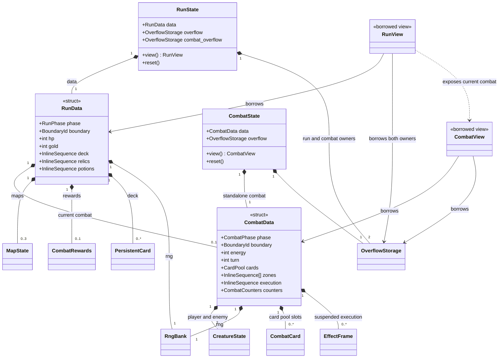
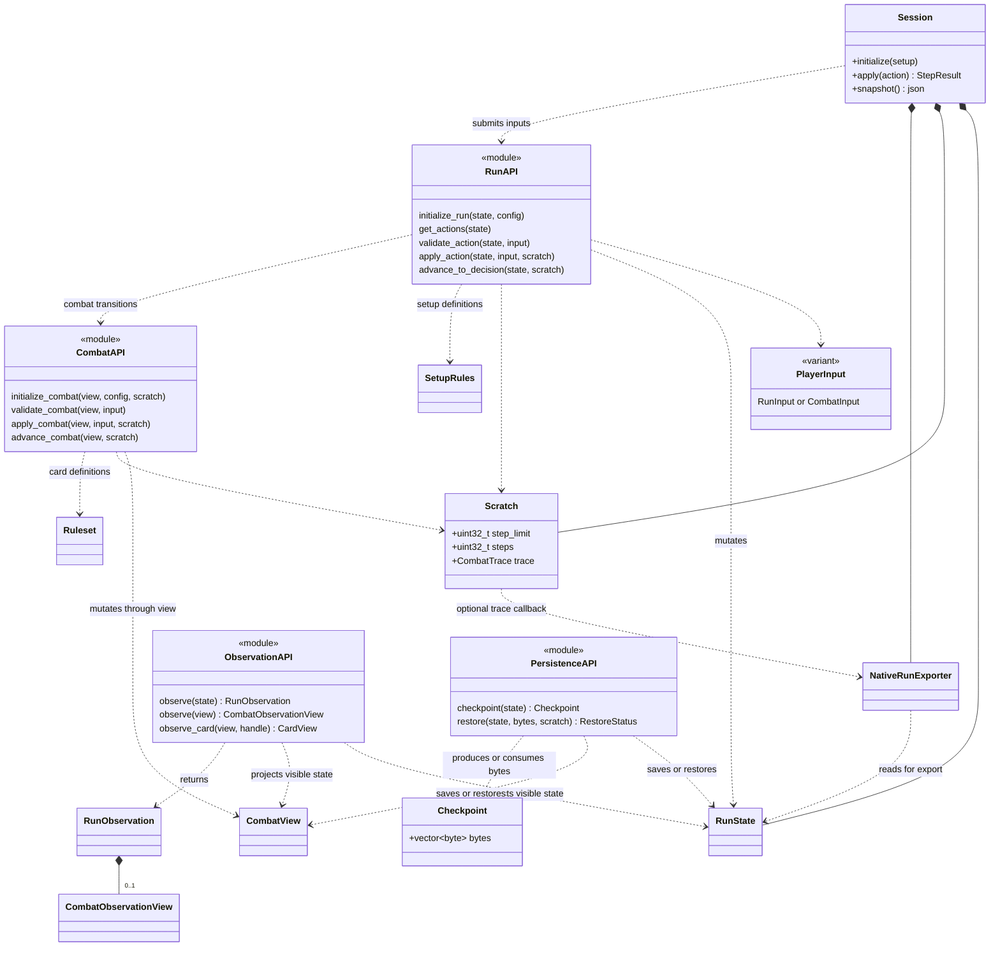

# C++ simulator UML

These diagrams describe the current public C++ headers, rather than the planned
full-game design. Members are selected for readability. Most types live in
`sts2::engine`; directories indicate module boundaries, not separate namespaces.

## State ownership

`RunData` and `CombatData` are trivially copyable. `clone_into` copies their bytes
and independently clones any overflow storage. The owning `RunState` and
`CombatState` wrappers must not themselves be cloned with a raw `memcpy`.
An embedded run combat is `CombatData`, not a nested owning `CombatState`.
Mutable and const view aliases share the `BasicRunView` / `BasicCombatView`
templates. Card zones contain handles into the pool, rather than card copies.

## APIs and integration

Boxes marked `module` group free functions; they are not C++ classes.
Dashed arrows indicate use, solid diamonds indicate ownership.

`apply_action` advances automatic transitions to a decision or terminal result.
Inputs carry an expected boundary identity. Observations exclude hidden RNG,
draw order, and suspended execution. Some observation fields borrow state storage
and are invalidated by mutation. `Scratch` is discardable; authoritative
continuations live in state. Diagnostic exporter history belongs to the optional
integration layer and is not carried into cloned engine state.

The persistence API currently exposes byte checkpoints. JSON checkpoints are a
recorded direction in [ADR 0004](adr/0004-use-json-for-restorable-checkpoints.md),
not represented here as an implemented API.

## Source map

| Area | Headers |
| --- | --- |
| Owning state and views | `include/sts2/state/run.hpp`, `include/sts2/state/combat.hpp` |
| Inline and overflow storage | `include/sts2/core/inline_storage.hpp`, `include/sts2/core/storage.hpp` |
| Run actions and combat transitions | `include/sts2/engine/action.hpp`, `include/sts2/engine/run.hpp`, `include/sts2/engine/combat.hpp` |
| Definitions | `include/sts2/content/cards.hpp`, `include/sts2/content/catalog.hpp` |
| Player observations | `include/sts2/observation/run.hpp`, `include/sts2/observation/observe.hpp` |
| Checkpoints | `include/sts2/persistence/checkpoint.hpp` |
| JSON integration | `include/sts2/json_io/session.hpp`, `include/sts2/json_io/native_run.hpp` |
